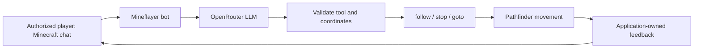

# Architecture and classroom choices

`unsupported` is a safe decision with no new action. The model returns one strict JSON object: tool plus nullable x/y/z fields. It never supplies JavaScript, shell code or Minecraft console commands. The application validates again after any gateway. Success feedback comes from movement events, not the model's claims.

The source has five small runtime modules: configuration, LLM HTTP adapter, tool validation, agent behavior and startup. The gateway is optional. Tests and instructor scripts are separate. No plugins are required on the Minecraft server.

| Option | Student effort | Teacher responsibility | Authentication/cost/network |
|---|---|---|---|
| Per-PC teacher-prepared Minecraft + personal OpenRouter key (selected) | Names, capped key in `.env`, start | Preinstall game/runtime/server; supervise accounts | Offline server loopback only. Each key has provider spending cap. HTTPS to OpenRouter. |
| Shared Minecraft server | Names plus provisioned bot login | Online-mode server, whitelist, bot accounts, player UUIDs, protected world | Unique authenticated game clients; controlled school network; class load test required. |
| Teacher AI gateway | Names plus private seat file | OpenRouter key, TLS endpoint, tokens, expiry, budgets, monitoring | No provider keys on student PCs. Backend controls two concurrent requests and persisted quotas. |
| Teacher-hosted Ollama | Names plus seat file | Model installation, inference machine, gateway and quality/latency pilot | No per-request provider bill; real hardware/resource costs. Ollama stays behind gateway. |
| Ollama on every student PC | Substantial setup | Many model downloads and heterogeneous hardware | Not selected; adds complexity and has not been performance-tested here. |

The original request preferred no student provider accounts. The user subsequently selected OpenRouter and explicitly requested a tutorial for each student's own API key. The shipped default follows that update; the gateway supports the original low-setup option.

The [current OpenRouter terms](https://openrouter.ai/terms) require age 18+. Personal key creation is documented for eligible adults/instructors. The intended 10–15 classroom deployment remains gated on a suitable approved arrangement or local model; a gateway alone does not remove terms or model eligibility requirements.

## Runtime boundaries

- Exact player identity; remote servers require Microsoft mode and expected UUID. Protocol player-chat sender identity is used, with no system-message regex fallback.
- `follow` targets only the requesting player. `goto` accepts integers in world bounds and within 64 blocks of both the current and initial position.
- Runtime checks bound follow distance and duration; navigation times out. No digging, block placement, towers, parkour or door interaction. Terrain can still be obstructed or unsafe; use the prepared practice world.
- One LLM request per instruction, no retries; four-second cooldown, one in flight, 30-second timeout, 240 input characters, 180 output tokens. No chat transcript or usernames are automatically sent to OpenRouter, only the instruction text and fixed tool prompt.
- `!stop` bypasses the model, cancels the pending request and invalidates late replies.
- No automatic reconnection. Clear error, then explicit restart after the environment is repaired.
- Provider errors/headers/bodies and credentials are not printed. Logs show permitted tool names and application-owned feedback. Local game logs may still contain chat and player names; keep them private.
- Secret/config/runtime files and Minecraft binaries/worlds are ignored by Git. `.gitignore` is not encryption, and copying a whole folder into a ZIP bypasses it.

## Official references checked

- [Mineflayer](https://github.com/PrismarineJS/mineflayer): supported Minecraft versions and Node requirement.
- [Pathfinder](https://github.com/PrismarineJS/mineflayer-pathfinder): movement settings, dynamic goals and stop behavior.
- [Minecraft protocol](https://github.com/PrismarineJS/node-minecraft-protocol): protocol version/authentication support.
- [Node release schedule](https://github.com/nodejs/Release): maintained runtime lines; the existing Node 24 installation was reused.
- [Paper server properties](https://docs.papermc.io/paper/reference/server-properties/): loopback binding and online-mode identity checks.
- [OpenRouter structured outputs](https://openrouter.ai/docs/guides/features/structured-outputs): schema-constrained responses and `require_parameters` routing. This adapter also disallows fallback providers and requests providers that do not collect data.
- [OpenRouter limits](https://openrouter.ai/docs/api/reference/limits): account/key credit controls.
- [Ollama chat API](https://docs.ollama.com/api/chat): optional local structured-output adapter; no Ollama runtime/model was installed or tested.

See the test report for exact versions and what was actually executed. Compatibility documentation alone is not test evidence.
